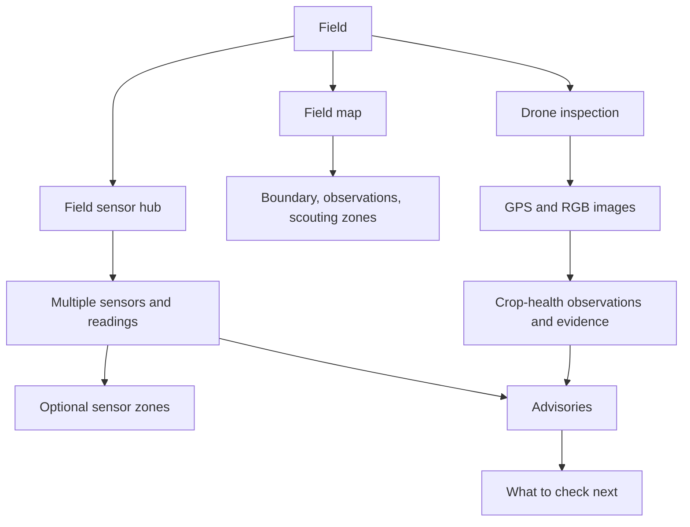

# PRITHVI field-first experience

PRITHVI is presented to farmers as one field assistant. A farmer creates a Field directly; the existing `Farm` record remains an internal compatibility parent for stored field records. Existing Farm and Field rows are not migrated or removed.

## Farmer-facing terminology

| Internal term | Farmer-facing term |
| --- | --- |
| Farm parent record | Hidden implementation detail |
| ESP32 / sensor node | Field sensor hub |
| Physical sensor | Field sensor (soil, temperature, humidity, rain) |
| MAVLink telemetry | Drone connection / drone location |
| ESP32-CAM | Field or drone camera |
| AI prediction | Crop-health screening or observation |
| Provider, API, endpoint, model runtime | Developer Diagnostics only |

## Field sensor hub and multiple sensors

One Field can have a sensor hub with multiple attached physical sensors. Each sensor stays an individual source and may optionally be assigned a farmer-friendly zone such as North, South, East, West, Center, or a named zone. Coordinates are optional. Sensor records and their historical readings remain tied to their source sensor; same-type readings are not averaged. Until calibration is saved, soil and rain values are shown as raw readings.

## Drone inspection

A drone is an optional inspection device associated with a Field through existing flight and observation records. PRITHVI presents connection, GPS readiness, battery, inspection history, and camera availability in farmer language. Telemetry remains read-only and PRITHVI does not control aircraft flight.

## Field map

The map renders only saved boundaries and real sensor locations, observations, inspection zones, drone position, and drone track points. Missing data stays visibly unavailable; no sample or placeholder marker is presented as a real measurement.

## Observation and advisory flow

Images and field observations retain their source, timestamp, location, evidence, and verification state. Screening results remain observations that need farmer verification where applicable. The existing advisory engine combines eligible observations, evidence, and sensor readings; an advisory explains the suggested next check and its supporting records. A low-confidence model result alone is not promoted to a farmer alert.

## Developer-facing terminology

Developer Diagnostics retains technical provider configuration, local URLs, device identifiers, protocols, runtime/model details, and raw status. These are operational tools and are not part of ordinary Field setup or the farmer's field overview.

## Setup principle

The required setup input is a Field name. Crop, variety, growth stage, boundary, hub, sensors, sensor zones, drone, weather location, and calibration remain optional and can be added later. Existing SQLite entities remain readable without recreating fields.
